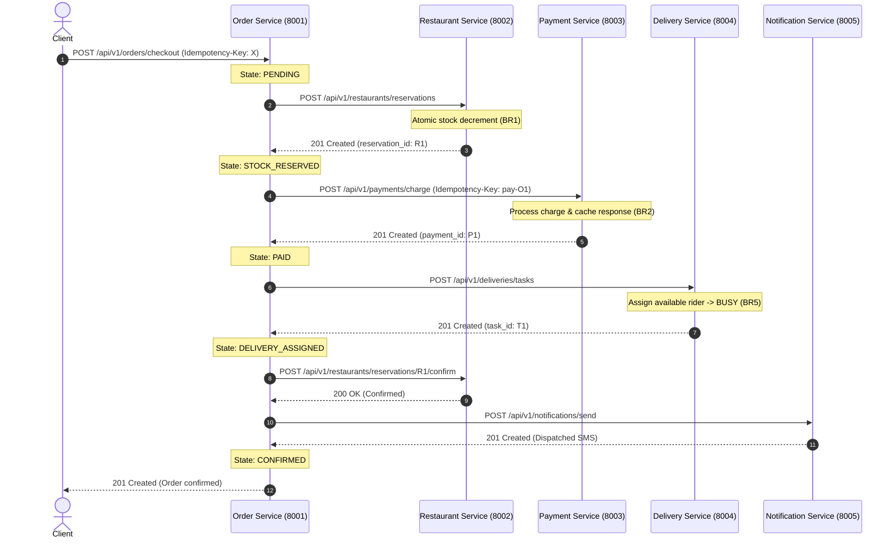
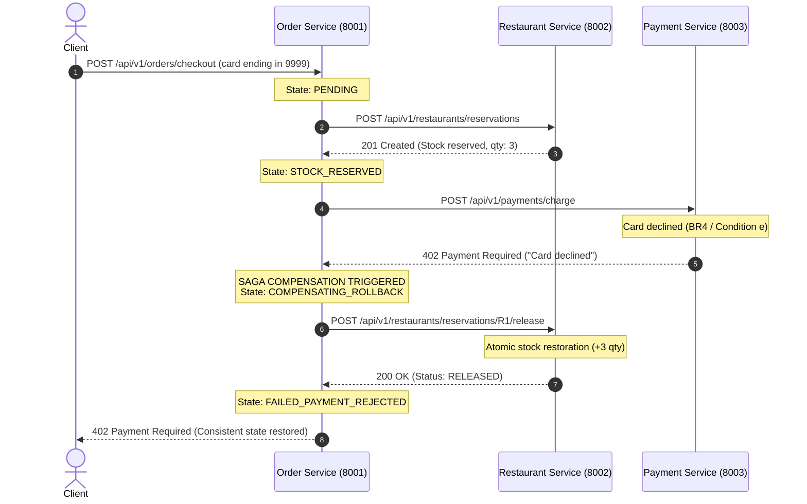
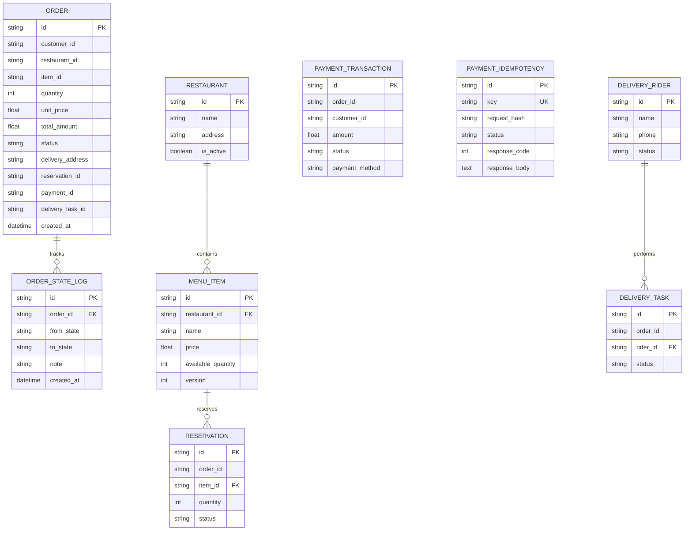

# FoodFlow: Design & Development of a Scalable Microservices Architecture
**Course**: Scalable Services (SEZG583) | MTech  
**Assignment**: Assignment 1 (13 Marks)  
**Team**: Group 26  
* **Kushagra Parashar** (`2025tm93126@wilp.bits-pilani.ac.in`)
* **Thamarai Muthu Selvi A** (`2025tm93028@wilp.bits-pilani.ac.in`)
* **Vijay Kumar Singh** (`2025tm93550@wilp.bits-pilani.ac.in`)
* **Hemanta Kumar Rana** (`2025tm93157@wilp.bits-pilani.ac.in`)  
**Repository**: [https://github.com/kush6542/Group26_Scalable_Services](https://github.com/kush6542/Group26_Scalable_Services)

---

## 1. Problem and Scope

### 1.1 Problem Overview
Modern food delivery platforms operate under extreme transactional concurrency, transient network unreliability, and cross-domain business workflows. A customer order is not a simple database update; it represents a distributed multi-service journey involving inventory locking, monetary transactions, logistics dispatching, and asynchronous customer notifications.

**FoodFlow** is a distributed microservices platform designed from first principles to solve these challenges. It eliminates single points of failure, avoids distributed deadlocks, guarantees data consistency without cross-database transactions, and handles concurrent bursts without resource over-allocation.

### 1.2 System Assumptions
1. Each microservice operates within its own bounded context and executes against its own isolated relational database (**Database-per-Service**).
2. Inter-service communication occurs synchronously over HTTP/REST using JSON payloads and standardized error representations.
3. Network calls between services are prone to latency and partial failure; all distributed transactions must provide explicit compensating rollbacks.
4. Downstream third-party providers (payment gateways, SMS providers) are mocked with controllable latency and failure injection for verification.

### 1.3 Core Business Rules (Traceability Matrix)

| Rule ID | Service | Rule Statement | Enforcement Mechanism | Test Name |
| :--- | :--- | :--- | :--- | :--- |
| **BR1** | Restaurant Service | An order item cannot be reserved if requested quantity exceeds available stock. Simultaneous requests must never over-allocate stock. | Atomic conditional SQL update (`UPDATE menu_items SET available_quantity = available_quantity - :qty WHERE available_quantity >= :qty`) | `test_br1_stock_sufficiency_*` |
| **BR2** | Payment Service | Repeating an unsafe request with an identical `Idempotency-Key` and matching payload must return the original cached response with no duplicate charge. | In-memory/DB idempotency table storing SHA-256 payload hash and cached JSON response | `test_br2_payment_idempotency_replay` |
| **BR3** | Payment & Order Services | Submitting an existing `Idempotency-Key` with an altered payload must be rejected with HTTP 409 Conflict. | SHA-256 fingerprint comparison at request entry | `test_br3_payment_idempotency_payload_mismatch` |
| **BR4** | Payment Service | Payment charges must have an amount $> 0$ and valid card details; test card ending in `9999` triggers simulated payment decline (HTTP 402). | Card validation logic & failure simulator | `test_payment_decline_simulation` |
| **BR5** | Delivery Service | A delivery task can only be assigned to a rider whose status is `AVAILABLE`. If all riders are busy, returns HTTP 409 Conflict. | Rider status filtering & atomic status lock to `BUSY` | `test_br5_rider_assignment_*` |
| **BR6** | Order Service | A multi-service checkout transaction must transition through explicit states (`PENDING` $\rightarrow$ `STOCK_RESERVED` $\rightarrow$ `PAID` $\rightarrow$ `DELIVERY_ASSIGNED` $\rightarrow$ `CONFIRMED`). | Orchestrated Saga engine with persistent state transition logging | `test_order_checkout_happy_path_saga` |
| **BR7** | Order Service | If a checkout step fails downstream, all preceding successful operations must be rolled back via compensating calls. | SAGA Compensator issuing reverse actions (refund, stock release, task cancel) | `test_order_checkout_payment_failure_compensation` |

### 1.4 Out of Scope
* User authentication and JWT authorization (simulated via client headers).
* Front-end UI (all interactions driven via REST APIs, Swagger UI, and automated test harnesses).
* Integration with real banking networks or live SMS gateways.

---

## 2. Service Decomposition

### 2.1 Service Responsibility & Ownership Table

| Service Name | Port | Database | Primary Business Responsibility | Owned Entities |
| :--- | :---: | :---: | :--- | :--- |
| **Order Service** | `8001` | `orders.db` | Coordinates the checkout saga, manages customer orders, and persists order state lifecycle transitions. | `Order`, `OrderStateLog`, `IdempotencyRecord` |
| **Restaurant Service** | `8002` | `restaurant.db` | Manages restaurant catalogs, menu items, dish pricing, and handles atomic stock reservations. | `Restaurant`, `MenuItem`, `Reservation` |
| **Payment Service** | `8003` | `payment.db` | Processes payments, provides cryptographic idempotency guarantees, handles refunds, and simulates gateway failures. | `PaymentTransaction`, `IdempotencyRecord` |
| **Delivery Service** | `8004` | `delivery.db` | Tracks delivery riders, manages driver availability, dispatches tasks, and handles logistics cancellations. | `DeliveryRider`, `DeliveryTask` |
| **Notification Service** | `8005` | `notification.db` | Dispatches customer and merchant alerts (SMS, Email, Push) with failure tolerance. | `NotificationLog` |

### 2.2 Boundary Rationale & Rejected Alternatives
* **Why this decomposition**: Each service aligns with an independent business capability (Domain-Driven Design bounded context). The rate of change and scalability characteristics of inventory (high read/write contention during flash deals) are decoupled from payment processing and physical logistics dispatch.
* **Rejected Alternative 1: Monolithic Order + Inventory Service**:
  * *Why rejected*: Coupling order placement with restaurant inventory creates a single bottleneck. Restaurants manage menus independently of orders. In Assignment 2, Restaurant Service may scale to 5 replicas during lunch peaks while Payment Service maintains fixed connections to upstream payment gateways.
* **Rejected Alternative 2: Database Layer / Controller Services**:
  * *Why rejected*: Splitting services by technical tier (e.g. "Database Service", "Validation Service") violates microservice cohesion principles and results in an anti-pattern distributed monolith.

---

## 3. Architecture & Transaction Workflows

### 3.1 Component Architecture Diagram

```mermaid
flowchart TD
    Client["Client / Automated Test Script"] -->|POST /api/v1/orders/checkout| OrderSvc["Order Service (Port 8001)\n[Saga Orchestrator]"]
    
    subgraph Core Services
        OrderSvc -->|1. POST /reservations| RestSvc["Restaurant Service (Port 8002)"]
        OrderSvc -->|2. POST /charge| PaySvc["Payment Service (Port 8003)"]
        OrderSvc -->|3. POST /tasks| DelivSvc["Delivery Service (Port 8004)"]
        OrderSvc -->|4. POST /send| NotifSvc["Notification Service (Port 8005)"]
    end

    subgraph Isolated Storage (Database-Per-Service)
        OrderSvc --- DB1[("orders.db")]
        RestSvc --- DB2[("restaurant.db")]
        PaySvc --- DB3[("payment.db")]
        DelivSvc --- DB4[("delivery.db")]
        NotifSvc --- DB5[("notification.db")]
    end
```

### 3.2 Sequence Diagram: Main Business Transaction (Happy Path)



### 3.3 Sequence Diagram: Partial Failure & SAGA Compensation (Failure Path)



---

## 4. Data Design & Isolation

### 4.1 Cross-Service Reference Strategy
To strictly maintain **Database-per-Service** separation:
* No shared tables or views exist across databases.
* Services store only **Foreign Identifiers** (UUID strings) of entities owned by other services (e.g., `Order.customer_id`, `Order.restaurant_id`, `Order.item_id`, `Order.payment_id`).
* Cross-service entity verification occurs via REST APIs at transaction time, never via database joins.

### 4.2 Entity Relationship Diagrams (Per Service)



---

## 5. API Design & OpenAPI Contracts

### 5.1 Endpoint Inventory

| Service | Method | Path | Status Codes | Description |
| :--- | :---: | :--- | :---: | :--- |
| **All Services** | `GET` | `/health` | 200 | Liveness & readiness probe |
| **Restaurant** | `GET` | `/api/v1/restaurants` | 200 | List active restaurants |
| **Restaurant** | `POST` | `/api/v1/restaurants` | 201, 422 | Register restaurant |
| **Restaurant** | `GET` | `/api/v1/restaurants/{id}/menu` | 200, 404 | List menu dishes & available stock |
| **Restaurant** | `POST` | `/api/v1/restaurants/{id}/menu` | 201, 404 | Add dish to menu |
| **Restaurant** | `POST` | `/api/v1/restaurants/reservations` | 201, 409, 404 | Atomic stock reservation (Challenge 1) |
| **Restaurant** | `POST` | `/api/v1/restaurants/reservations/{id}/release`| 200, 404 | Saga compensating release (Challenge 3C) |
| **Payment** | `POST` | `/api/v1/payments/charge` | 201, 402, 409 | Idempotent charge (Challenge 2) |
| **Payment** | `POST` | `/api/v1/payments/{id}/refund` | 200, 404 | Saga compensating refund |
| **Delivery** | `GET` | `/api/v1/deliveries/riders` | 200 | List available/busy riders |
| **Delivery** | `POST` | `/api/v1/deliveries/riders` | 201 | Register rider |
| **Delivery** | `POST` | `/api/v1/deliveries/tasks` | 201, 409 | Dispatch delivery to available rider |
| **Delivery** | `POST` | `/api/v1/deliveries/tasks/{id}/cancel` | 200, 404 | Compensating rider release |
| **Order** | `POST` | `/api/v1/orders/checkout` | 201, 402, 409 | Multi-service Saga Checkout |
| **Order** | `GET` | `/api/v1/orders/{id}` | 200, 404 | Order query with state logs |
| **Notification** | `POST` | `/api/v1/notifications/send` | 201, 503 | Send customer/merchant alert |

### 5.2 Uniform JSON Error Model
Every service implements identical error responses:
```json
{
  "error": {
    "code": "STOCK_INSUFFICIENT",
    "message": "Stock insufficient: requested 1, only 0 remaining.",
    "details": {}
  },
  "correlation_id": "corr-conc-06-a831ef"
}
```

---

## 6. Engineering Challenges: Deep-Dive Analysis

### Challenge 1: Concurrency Control (Mandatory)
* **Problem**: Preventing inventory over-allocation when 20 simultaneous threads request a dish with capacity 5.
* **Design Choice**: Atomic Conditional Database Update (`UPDATE menu_items SET available_quantity = available_quantity - :qty WHERE available_quantity >= :qty`).
* **Why Application Check-Then-Update Fails**: Check-then-update exhibits a classic read-modify-write hazard. Multiple concurrent worker processes read identical uncommitted stock, evaluate the quantity as valid, and write deductions concurrently, yielding severe negative inventory.
* **Evidence**:
  * Script: `scripts/test_challenge1_concurrency.py`
  * Execution: Fired 20 concurrent threads against 5 stock units. Exactly 5 returned HTTP 201, exactly 15 returned HTTP 409. Final stock verified at 0. (See `evidence/challenge-1-concurrency/concurrency_run_output.txt`).

### Challenge 2: Idempotency Enforcement (Mandatory)
* **Problem**: Preventing double charges or duplicate orders when clients retry unsafe operations over unreliable networks.
* **Design Choice**: Header `Idempotency-Key` + SHA-256 Request Fingerprinting + Unique DB Constraint.
* **Why Sequential-Only Testing is Insufficient**: Two duplicate network packets can arrive at the server concurrently. A plain `SELECT key` before `INSERT` suffers from a race condition. By placing a database unique constraint on `idempotency_records.key`, the database enforces serialization.
* **Evidence**:
  * Script: `scripts/test_challenge2_idempotency.py`
  * Execution: Tested sequential repeat, payload alteration rejection (HTTP 409), and 10 parallel simultaneous requests. Database audit proved exactly 1 charge record created. (See `evidence/challenge-2-idempotency/idempotency_run_output.txt`).

### Challenge 3C: Orchestrated Saga with Compensation (Elective)
* **Problem**: Maintaining distributed consistency across isolated microservice databases without distributed 2-Phase Commit locks.
* **Design Choice**: Centralized Orchestrator in Order Service with persistent state machine logs and automated compensating reversal actions.
* **Evidence**:
  * Script: `scripts/test_challenge3_saga.py`
  * Scenarios Tested:
    1. Happy Path: `PENDING` $\rightarrow$ `STOCK_RESERVED` $\rightarrow$ `PAID` $\rightarrow$ `DELIVERY_ASSIGNED` $\rightarrow$ `CONFIRMED`.
    2. Step 2 Payment Failure: Card declined $\rightarrow$ `COMPENSATING_ROLLBACK` releases reserved restaurant stock $\rightarrow$ `FAILED_PAYMENT_REJECTED`. Stock restored from 5 back to 8.
    3. Step 3 Delivery Failure: No riders $\rightarrow$ `COMPENSATING_ROLLBACK` refunds payment and releases stock $\rightarrow$ `FAILED_NO_RIDER_AVAILABLE`. Both payments and stock restored. (See `evidence/challenge-3-saga/saga_run_output.txt`).

---

## 7. Testing Strategy & Results

1. **Unit Testing**: 20 unit tests across all 5 services covering business rules BR1 to BR7 (`pytest services/`).
   * **Result**: **20 passed in 0.38s**.
2. **End-to-End Testing**: `scripts/test_e2e_flow.py` verifies full lifecycle across running services.
   * **Result**: **100% success**.

---

## 8. Architectural Decisions & Trade-Offs

### Decision 1: Database-per-Service vs. Shared Database
* **Chosen**: Database-per-Service (SQLite / PostgreSQL per service).
* **Rationale**: Eliminates hidden coupling, ensures schema changes in one service do not break others, and aligns with Docker/Kubernetes pod isolation in Assignment 2.
* **Trade-off**: Requires Saga rollbacks rather than native database transactions.

### Decision 2: Orchestrated Saga vs. Choreographed Saga
* **Chosen**: Orchestrated Saga (Order Service as coordinator).
* **Rationale**: Order Service retains explicit, centralized visibility over the transaction state machine. Compensating actions and failure diagnostics are straightforward to debug and trace.
* **Trade-off**: Order Service has coupling to the APIs of downstream services.

### Decision 3: Atomic Conditional SQL Updates vs. Distributed Redis Locks
* **Chosen**: Atomic Conditional SQL Update (`available_quantity >= :qty`).
* **Rationale**: Leverages the ACID guarantees of the relational engine without introducing external distributed locking dependencies, lock TTL expiration bugs, or split-brain hazards.
* **Trade-off**: Database handles the contention serialization.

---

## 9. Limitations & Future Work
* **Limitations**: Current inter-service communication is synchronous REST. High network latencies compound across multi-step transactions.
* **Future Work (Assignment 2)**: Containerization with Docker Compose and Minikube; integration of message broker (RabbitMQ/Kafka) for asynchronous notification dispatch.

---

## 10. Links & Artifacts
* **GitHub Repository**: [https://github.com/kush6542/Group26_Scalable_Services](https://github.com/kush6542/Group26_Scalable_Services)
* **Google Drive (Demo Video & Report PDF)**: [Drive Folder Link]

---

## Appendix A: Video Presentation Outline (8 to 10 Minutes)
* **0:00 - 1:00 (1 min)**: Team introduction, service ownership, domain overview.
* **1:00 - 3:00 (2 min)**: Architectural walkthrough: 5 services, Database-per-Service, state machine.
* **3:00 - 6:00 (3 min)**: Live demo of End-to-End checkout (happy path) and simulated card decline (failure compensation).
* **6:00 - 9:00 (3 min)**: Live execution of Challenge scripts:
  * Challenge 1: 20 parallel threads vs capacity 5.
  * Challenge 2: Idempotent replays and payload conflict.
  * Challenge 3C: Saga compensating multi-service rollbacks.
* **9:00 - 10:00 (1 min)**: Wrap-up, trade-offs, and transition to Assignment 2 containerization.

---

## Appendix B: Student Contributions & Reflections

### B.1 Contribution Matrix

| Student Name | Student ID / Email | Service Owned | Key Contributions |
| :--- | :--- | :--- | :--- |
| **Kushagra Parashar** | `2025tm93126@wilp.bits-pilani.ac.in` | **Order Service** & **Restaurant Service** | Architected the core multi-service checkout Saga Orchestrator, persistent state machine, and Challenge 1 atomic SQL concurrency control (`available_quantity >= :qty`). Built end-to-end integration test harness and unified service runner. |
| **Thamarai Muthu Selvi A** | `2025tm93028@wilp.bits-pilani.ac.in` | **Payment Service** | Implemented Challenge 2 idempotency engine with cryptographic SHA-256 request payload hashing, database unique constraints for concurrent race protection, and simulated failure injection for Saga rollbacks. |
| **Vijay Kumar Singh** | `2025tm93550@wilp.bits-pilani.ac.in` | **Delivery Service** | Engineered the rider registry, rider status locking (`AVAILABLE` -> `BUSY`), delivery task allocation lifecycle, and compensating cancellation endpoints for multi-step Saga rollbacks. |
| **Hemanta Kumar Rana** | `2025tm93157@wilp.bits-pilani.ac.in` | **Notification Service** | Developed the multi-channel notification dispatching service (SMS, Email, Push), third-party gateway failure simulation, health probe monitoring, and distributed correlation ID tracing middleware. |

### B.2 Individual Reflections

#### 1. Kushagra Parashar (Order Service & Restaurant Service)
* **What I Built**: I developed the Order Service and the Restaurant Service. In Order Service, I built the centralized Saga Orchestrator that coordinates the distributed business transaction across four independent services and logs explicit state machine transitions (`PENDING`, `STOCK_RESERVED`, `PAID`, `DELIVERY_ASSIGNED`, `CONFIRMED`, `COMPENSATING_ROLLBACK`). In Restaurant Service, I implemented the catalog, menu inventory, and atomic conditional stock updates for Challenge 1.
* **Hardest Problem Solved**: Eliminating race conditions under simultaneous bursts. When 20 threads hit a single menu item with capacity 5, naive application code ("check-then-update") caused extreme over-allocation. I solved this by pushing the concurrency check into an atomic SQL `UPDATE ... WHERE available_quantity >= :qty` statement, mathematically preventing overselling while avoiding coarse table locks.
* **What I Would Change**: In future iterations (Assignment 2), I would introduce an asynchronous message broker (such as Kafka or RabbitMQ) to decouple the Saga steps, transitioning from synchronous HTTP orchestration to event-driven choreography for non-blocking scale.

#### 2. Thamarai Muthu Selvi A (Payment Service)
* **What I Built**: I designed and developed the Payment Service, including charge processing, compensating refund endpoints, and the complete Idempotency Engine (Challenge 2) to prevent double debits during network retries or duplicate clicks.
* **Hardest Problem Solved**: Handling concurrent duplicate hits arriving at the exact same millisecond. A standard check-then-store lookup fails under simultaneous identical requests due to read-commit latencies. I solved this by adding a database-level unique constraint on `idempotency_records.key` paired with `IN_PROGRESS` state tracking, guaranteeing that exactly one transaction executes while concurrent duplicates await the cached result.
* **What I Would Change**: I would add time-to-live (TTL) expiration on the idempotency cache records and implement automated token bucket rate-limiting to protect payment gateways from distributed denial-of-service traffic.

#### 3. Vijay Kumar Singh (Delivery Service)
* **What I Built**: I implemented the Delivery Service responsible for tracking rider states (`AVAILABLE`, `BUSY`, `OFFLINE`), dispatching delivery tasks to eligible couriers, and providing a compensating `POST /tasks/{id}/cancel` endpoint.
* **Hardest Problem Solved**: Managing the logistics compensation lifecycle during Saga rollbacks. When downstream operations fail, the delivery task must not only be marked `CANCELLED`, but the assigned rider must be atomically restored to `AVAILABLE` status without creating orphaned driver states.
* **What I Would Change**: I would incorporate geo-spatial proximity indexing (e.g., PostGIS) so that riders are dispatched based on real-time Euclidean or road distance to the pickup restaurant rather than first-available FIFO order.

#### 4. Hemanta Kumar Rana (Notification Service)
* **What I Built**: I developed the Notification Service handling SMS, email, and push alerts with persistent dispatch logging, simulated gateway unreachability (HTTP 503), and distributed tracing middleware.
* **Hardest Problem Solved**: Establishing end-to-end observability and log correlation. In a distributed multi-service setup, debugging errors without unified identifiers is impossible. I helped implement the `CorrelationIdMiddleware` that extracts or generates `X-Correlation-ID` and propagates it across all service-to-service HTTP headers and log streams.
* **What I Would Change**: I would implement an outbox pattern with dead-letter queue (DLQ) retry mechanisms so that temporary notification provider failures do not lose pending alerts.

---

## Appendix C: AI-Use Declaration
AI assistance (Google Gemini / Antigravity) was utilized for generating boilerplate code scaffolding, writing repetitive test client assertions, and formatting documentation. All core architectural decisions, concurrency mechanics, idempotency hashing algorithms, and distributed Saga state machines were reviewed, verified, and executed by the team.
